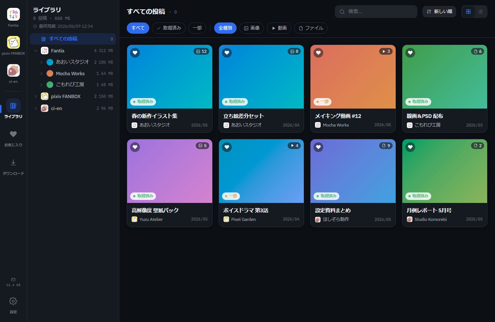
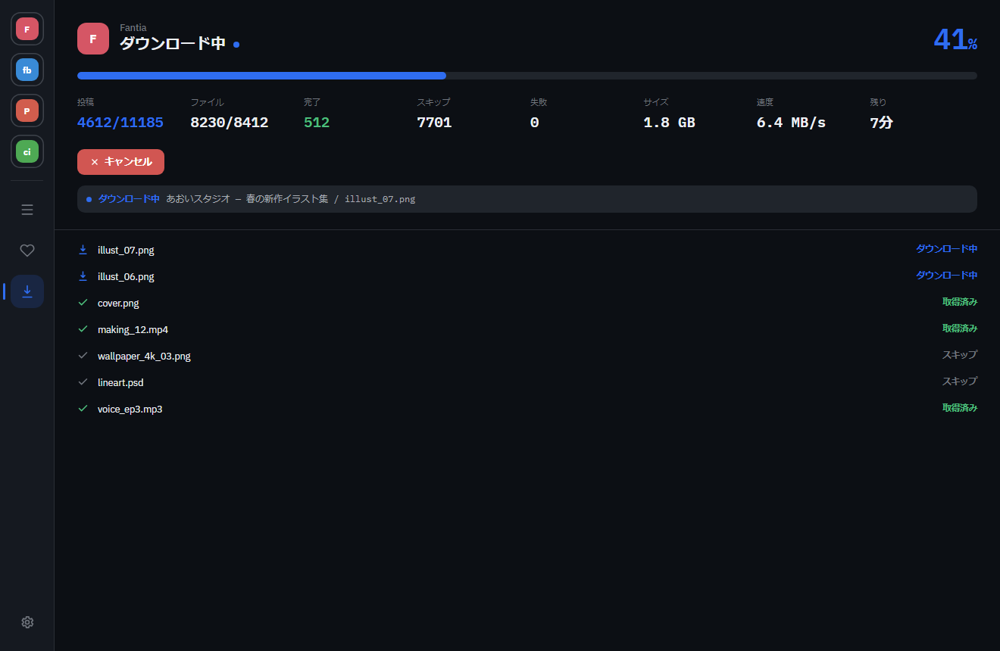

# fc-downloader

[日本語](README.md) | English | [简体中文](README.zh-CN.md)

A desktop app that **downloads the content you support on Fantia / pixiv FANBOX / Patreon / ci-en
to your own PC and lets you browse it there**.

This is the English version of the [project README](README.md).

<p align="center">
  
</p>

> The screenshot uses sample (mock) data.

---

## Features

- 🔒 **Everything stays on your PC** — downloaded files are never sent anywhere.
- 🧩 **Just your usual login** — sign in to each site in the app's built-in browser; no setup needed. If a sign-in
  can't be completed inside the app, you can paste a cookie value from your regular browser instead.
- ⬇️ **Bulk download** — pick creators, file types and a period (last N days / date range / since your last download)
  and click once. Files you already have are skipped and failed files are retried automatically.
- 🛒 **Fantia purchases too** — besides supported posts, files of shop products you bought are saved as well.
- 🆕 **See what's new** — creators with new posts you haven't downloaded yet are marked "New" (pixiv FANBOX, ci-en).
- 🖼️ **View right away** — preview images, video and audio in the app. Extract zip files (including
  password-protected ones), and view PSD layers and export images.
- 📁 **Your folder layout** — set folder-name patterns using the creator name, post title and more.
- ⚙️ **Automation** — download from all sites at once, or automatically every day.
- 🌐 **日本語 / English / 简体中文** — switch the UI language.

---

## Install

[**Download the latest release**](https://github.com/ryoctrl/fc-downloader/releases/latest) and pick the file for your OS.

### 🪟 Windows

**Installer** — recommended

1. Download `fc-downloader-x.x.x-x64.exe` and **run it**.
2. If "Windows protected your PC" appears, choose **"More info" → "Run anyway"** to continue.
3. Once installed, the app starts without the warning.

**Portable (no install)**

1. Download `fc-downloader-x.x.x-portable.zip`.
2. **Right-click the zip → "Properties" → check "Unblock" → OK**.
3. **Extract** the zip and run the `.exe` inside.

> 💡 The warning is not a virus alert: the builds are distributed without a code signature.
> Make sure you downloaded the file from the release page above.

### 🍎 macOS

1. Download and open `fc-downloader-x.x.x-universal.dmg`.
2. Drag `fc-downloader` into the "Applications" folder.
3. If macOS says it can't be opened, **right-click `fc-downloader` → "Open"**.

> When a new version is released, the app shows a notice at the top on startup (you download it yourself).

---

## Usage

#### 1. Sign in and download

Pick a site from the menu on the left and sign in as usual. Choose creators and file types, then press "Download".
Along with progress, speed and time remaining, the app shows **what it is doing right now** in real time.

<p align="center">
  
</p>

- **Period**: choose "All", "Recent" (last N days), "Range", or "Since last" (per creator, only posts after the
  last download that finished completely).
- **Creators missing from the list** (Patreon): open the creator's page and use "Add the creator shown".
- **If you can't sign in** (Fantia, pixiv FANBOX, Patreon): in Settings → "Accounts / Cookies" → "Paste cookie",
  paste the cookie value from a regular browser where you are signed in. The value is stored only as that
  site's login.

#### 2. Browse your library

Downloads appear in the "Library". Open a post from its thumbnail to view images, video and audio, and add it to
your favorites. Use "Extract" for zip files (the password is remembered per post) and "Open PSD" to toggle layers
and export images.

#### 3. Settings and automation

In Settings you can hide sites you don't use, run a **download from all sites**, schedule a **daily download**,
**launch the app at login**, and set the **folder-name patterns** and the **UI language**.

> Files are saved to "Documents / fc-downloader" by default (changeable in Settings).

---

## Supported sites

| Site | Status |
| --- | --- |
| pixiv FANBOX | ✅ Supported |
| Fantia | ✅ Supported (including purchased shop products) |
| ci-en | ✅ Supported |
| Patreon | ⚠️ Sign-in and the creator list (paid and free memberships) work. Downloading posts has not yet been checked with an account that has an active paid pledge |

---

## Build from source

Development uses Node.js 24 and npm. Dependency versions are pinned by `package-lock.json`.

```bash
npm ci
npm run dev
```

Checks and build:

```bash
npm run typecheck
npm run lint
npm test
npm run build
```

See the [contributing guide](CONTRIBUTING.en.md) for the full workflow.

### Translations

- Japanese and English strings: [`src/renderer/src/design/i18n.ts`](src/renderer/src/design/i18n.ts).
- Simplified Chinese strings: [`src/renderer/src/design/locales/zh-CN.ts`](src/renderer/src/design/locales/zh-CN.ts).
- Language options and system-language matching: [`src/renderer/src/design/language.ts`](src/renderer/src/design/language.ts).
- Keep placeholders such as `{name}`, `{n}` and `{postId}` as they are;
  [`i18n.test.ts`](src/renderer/src/design/i18n.test.ts) checks keys and placeholders across languages.

---

## ⚠️ Disclaimer (please read)

- This app is a tool for **personally backing up and viewing content you support**.
  Follow each site's terms of service and **do not redistribute, share or repost downloaded content**.
- The app is provided **"AS IS"**, without warranty of any kind, express or implied, including accuracy,
  completeness or fitness for a particular purpose.
- **The author accepts no liability for any damage or loss arising from the use of, or inability to use,
  this app.** This includes, without limitation, loss or corruption of data, restriction or suspension of
  accounts, malfunctions caused by changes to the target sites, and any other direct or indirect damage.
- Using this app, and complying with each site's terms and applicable laws while doing so, is
  **entirely your own responsibility**.

The [Japanese README](README.md) is the original text; if the translations differ, the Japanese version prevails.

---

## License

The **source code** of this app is released under the [MIT License](LICENSE).

> ⚠️ The MIT License covers **only the code of this app**. Rights to the **content you download** with it
> belong to the respective creators / services. This license does not grant any permission to redistribute
> or use that content (see the disclaimer above).

---

<sub>See [CONTRIBUTING.en.md](CONTRIBUTING.en.md) to contribute and [SECURITY.md](SECURITY.md) to report a vulnerability. Developer docs (setup, design) are in [CLAUDE.md](CLAUDE.md) and [docs/](docs/) (mostly in Japanese).
The screenshots use mock data generated by [`scripts/gen-mock-screenshots.cjs`](scripts/gen-mock-screenshots.cjs).</sub>
