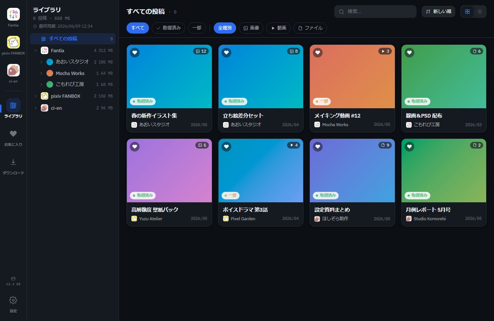
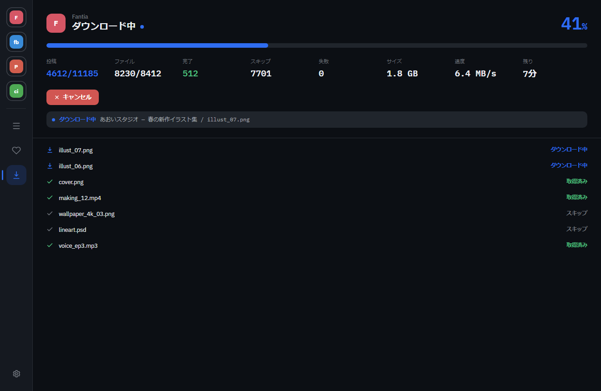

# fc-downloader

[日本語](README.md) | 简体中文

将你在 **Fantia / pixiv FANBOX / Patreon / ci-en** 上支持的创作者内容，**批量下载到自己的电脑并直接浏览**的桌面应用。

本文是[项目说明](README.md)的简体中文版本，包含功能介绍、安装与使用方法，以及语言设置与源码构建说明。

<p align="center">
  
</p>

> 上图使用模拟数据，截图中的界面语言以示例为准。

---

## 主要功能

- 🔒 **在本机处理**：下载的文件保存在自己的电脑上，不会由应用上传到外部服务器。
- 🧩 **使用常规登录方式**：在应用内置浏览器中登录各站点，无须复杂配置。
- ⬇️ **批量保存**：选择创作者与文件类型，即可批量下载，支持继续下载和自动重试。
- 🖼️ **直接浏览**：在应用内预览图片、视频、音频和 ZIP 压缩包中的内容。
- ⚙️ **自动执行**：支持所有站点一键批量下载，以及每天定时下载。

---

## 简体中文界面

在左侧进入 **Settings / 設定 → General / 一般 → Language / 言語 → 简体中文**，即可即时切换。语言选择保存在本机，重启后继续生效。

首次使用时，根据系统首选语言选择界面语言。中文系统使用简体中文；已有用户保存的日语或英语选择会保留。目前暂未提供繁体中文译文，中文地区的系统语言统一回退到简体中文。

本地化覆盖导航、下载设置、创作者筛选、下载状态、媒体库、收藏、ZIP / PSD 查看器、Cookie 导入、定时下载及常规设置。站点内嵌网页、创作者姓名、帖子正文、文件名和原始服务端诊断消息保留原文。

---

## 安装

[下载最新版](https://github.com/ryoctrl/fc-downloader/releases/latest)，并选择与你的操作系统对应的文件。也可以按下文的[源码构建方法](#从源码运行与构建)自行构建。

### 🪟 Windows

**安装版**（推荐）

1. 下载并运行 `fc-downloader-x.x.x-x64.exe`。
2. 如果系统显示「Windows 已保护你的电脑」，在核对来源后，可选择「更多信息 → 仍要运行」继续安装。
3. 安装完成后，从安装位置启动应用。

**便携版**（免安装）

1. 下载 `fc-downloader-x.x.x-portable.zip`。
2. 在核对来源后右键 ZIP 文件，打开「属性」，勾选「解除锁定」（系统显示名称可能不同），然后确认。
3. 解压 ZIP 文件，运行其中的 `.exe`。

> 构建未进行代码签名，因此首次运行时可能出现系统安全提示。未签名提示本身不能证明文件安全，应核对下载来源。

### 🍎 macOS

1. 下载并打开 `fc-downloader-x.x.x-universal.dmg`。
2. 将 `fc-downloader` 拖入「应用程序」文件夹。
3. 如果系统提示无法打开，在核对来源后，可右键应用并选择「打开」。

---

## 使用方法

### 1. 登录并下载

在左侧菜单选择站点，按平常的方式登录。勾选创作者与文件类型，然后点击「开始批量下载」。

应用会实时显示进度、速度、预计剩余时间，以及当前正在执行的操作。

<p align="center">
  
</p>

下载类型支持图片、视频、音频和附件。可选全部历史帖子、最近若干天、指定日期，或上次完整下载后的新帖子；已下载内容可跳过。

### 2. 在媒体库中浏览

已下载的帖子会显示在「媒体库」。通过缩略图打开帖子后，可以直接查看图片、视频和音频。

### 3. 设置与自动下载

在「设置」中，可以隐藏不用的站点、执行**全部站点批量下载**、设置**每天定时下载**，以及开启**登录电脑后自动启动应用**。

> 默认保存位置为「文档 / fc-downloader」，可在设置中修改。

---

## 支持的站点

| 站点         | 状态                                        |
| ------------ | ------------------------------------------- |
| pixiv FANBOX | ✅ 可用                                     |
| Fantia       | ✅ 可用                                     |
| ci-en        | ✅ 可用                                     |
| Patreon      | ⚠️ 可以登录；帖子获取在部分环境下仍未经验证 |

---

## 从源码运行与构建

开发与构建使用 Node.js 24 和 npm。依赖版本以 `package-lock.json` 为准。

```bash
npm ci
npm run dev
```

检查与构建：

```bash
npm run typecheck
npm run lint
npm test
npm run build
```

`npm run build` 包含主进程与界面的 TypeScript 检查。Windows 便携版可使用以下命令打包，输出在 `release/`：

```bash
npm run build
npx electron-builder --win portable --x64 --publish never
```

更多开发流程见[中文贡献指南](CONTRIBUTING.zh-CN.md)。

## 翻译维护

- 中文字典：[`src/renderer/src/design/locales/zh-CN.ts`](src/renderer/src/design/locales/zh-CN.ts)。
- 语言选项与系统语言匹配：[`src/renderer/src/design/language.ts`](src/renderer/src/design/language.ts)。
- `{name}`、`{n}`、`{postId}` 等占位符需要保持原样。
- [`i18n.test.ts`](src/renderer/src/design/i18n.test.ts) 检查语言字典键名、占位符和系统语言匹配，避免缺失译文或显示未替换的变量。

---

## 免责声明

- 本应用用于**对自己已支持、具有访问权限的内容进行个人备份和浏览**。请遵守各站点的使用条款，**不要再次分发、共享或转载已下载的内容**。
- 本应用按**现状（AS IS）**提供，不对运行的准确性、完整性或特定用途的适用性作出任何明示或默示保证。
- **对于使用本应用或无法使用本应用所造成的任何损害或损失，作者均不承担责任。** 这包括但不限于数据丢失或损坏、账号受到限制或停用、目标站点变更导致的故障，以及其他直接或间接损害。
- 使用本应用，以及遵守相关站点条款和适用法律，均由**使用者自行负责**。

---

## 许可证

本应用的**源代码**采用 [MIT License](LICENSE) 开源。

> MIT 许可证仅适用于本应用的代码。通过应用下载的内容，其权利仍归各创作者或服务提供方所有；本许可证不授予再次分发或使用这些内容的权利。请同时参阅上方的[免责声明](#免责声明)。

---

参与开发请阅读[中文贡献指南](CONTRIBUTING.zh-CN.md)（[日文原文](CONTRIBUTING.md)）；报告安全漏洞请阅读 [SECURITY.md](SECURITY.md)。开发环境与设计资料见 [CLAUDE.md](CLAUDE.md) 和 [docs/](docs/)。

README 中的示例截图使用模拟数据，由 [`scripts/gen-mock-screenshots.cjs`](scripts/gen-mock-screenshots.cjs) 生成。
